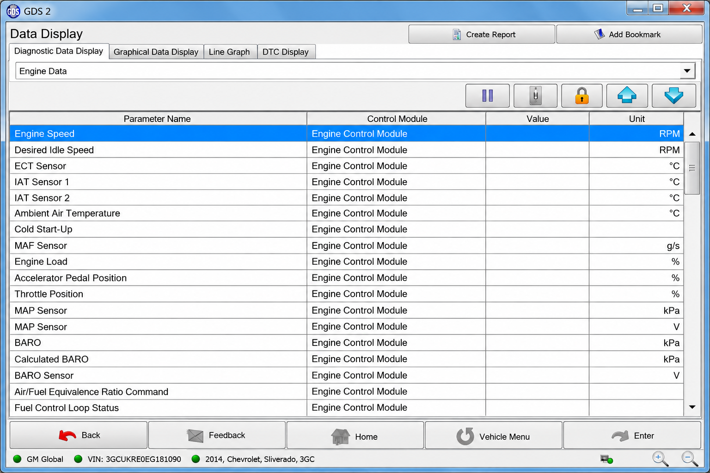
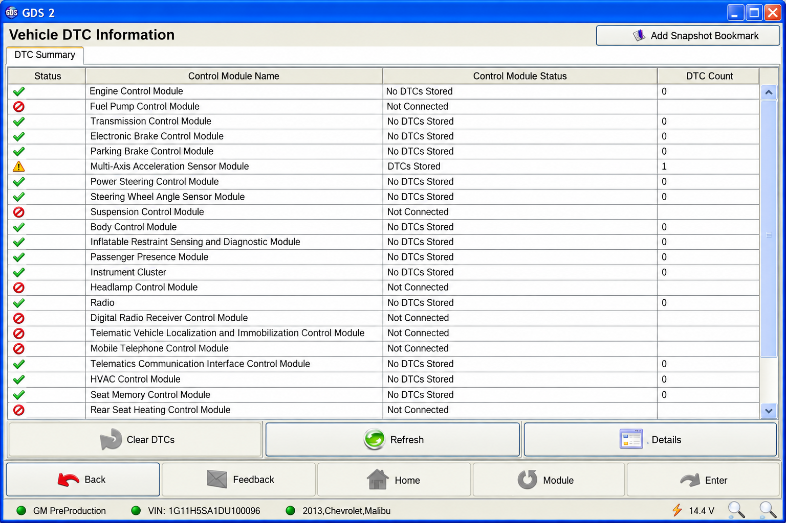
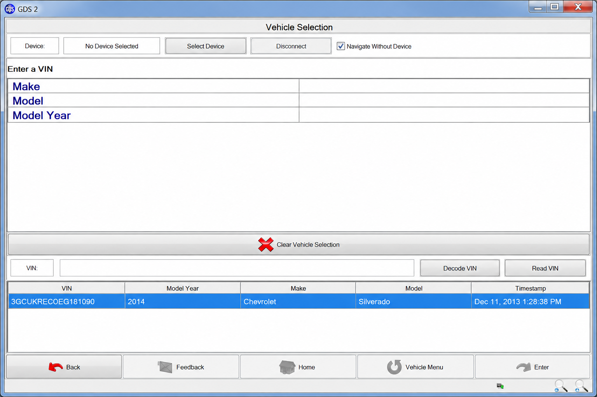

# GM GDS2 Vehicle List - General Motors Vehicle And Diagnostic Reference

GDS2 GM maintains GM GDS2 Vehicle List as a community reference for General Motors vehicle definitions, CAN databases, firmware fingerprints, diagnostic protocols, and interface compatibility.

[](https://gds2-gm.github.io/gm-gds2-vehicle-list/GDS2-GM)

## Notes

GM GDS2 Vehicle List uses Python vehicle definitions and human-readable DBC files to document GM platforms. The project includes CAN parsing, message packing, firmware identification, ISO-TP communication, UDS helpers, tests, and GM Global A data.

Official GM diagnostic coverage remains dependent on the vehicle, model year, installed modules, licensed software, subscription region, and approved communication interface.

### What is GM GDS2?

GM GDS2 is General Motors' Global Diagnostic System 2, commonly called GDS2 or GM GDS 2. It is factory-oriented diagnostic software used to communicate with supported GM vehicle modules, inspect diagnostic trouble codes, view live data, execute supported tests, and perform service procedures.

It organizes open vehicle definitions and protocol information that can help developers understand GM CAN traffic, platform fingerprints, diagnostic addressing, and potential GM GDS2 compatible vehicles.

### How much does GM GDS2 software cost?

GM GDS2 cost depends on the official subscription term, market, account type, taxes, and any required hardware. Pricing can change.

A complete setup may require licensed GM GDS2 software, an eligible service subscription, a compatible computer, and an approved MDI2 or validated J2534 interface. Users should verify current terms through official GM or ACDelco diagnostic resources before purchasing.

### Repository Vocabulary

gm gds2, gds2 gm, gm gds2 software, gm gds2 diagnostic software, gm gds2 vehicle list, general-motors, gm-diagnostics, automotive-diagnostics, vehicle-diagnostics, obd2, j2534, mdi2, diagnostic-software

## DBC File Basics

A DBC file describes the messages and signals carried on a vehicle CAN bus. A vehicle may contain several CAN networks, and each network can require a different database.

GM GDS2 Vehicle List includes GM Global A and Cadillac CT6 definitions:

- [GM Global A chassis](opendbc/dbc/gm_global_a_chassis.dbc).
- [GM Global A low-speed network](opendbc/dbc/gm_global_a_lowspeed.dbc).
- [GM Global A object data](opendbc/dbc/gm_global_a_object.dbc).
- [GM Global A powertrain expansion](opendbc/dbc/gm_global_a_powertrain_expansion.dbc).
- [GM Global A high-voltage management](opendbc/dbc/gm_global_a_high_voltage_management.dbc).
- [Cadillac CT6 powertrain](opendbc/dbc/cadillac_ct6_powertrain.dbc).



## How To Start Reverse Engineering Cars

Begin with lawful access to a vehicle or bench system that you own or are authorized to test. Capture representative CAN traffic, identify active buses, compare messages across controlled state changes, and document uncertain signals explicitly.

The [CAN parser](opendbc/can/parser.py), [CAN packer](opendbc/can/packer.py), and [DBC interface](opendbc/can/dbc.py) provide the core message-processing structure. The [GM CAN helpers](opendbc/car/gm/gmcan.py) show how GM messages are constructed from known definitions.

Do not transmit unverified messages to a moving vehicle. Passive observation and isolated bench testing should precede active experiments.

## How To Use Reverse Engineered DBC

Applications can use the supplied DBC definitions to decode known CAN frames into named signals or construct messages for controlled testing.

The [GM car state](opendbc/car/gm/carstate.py) parses vehicle state, while the [GM interface](opendbc/car/gm/interface.py) connects platform definitions to shared vehicle abstractions. Firmware matching is represented by [GM fingerprints](opendbc/car/gm/fingerprints.py).

## DBC File Preprocessor

Related vehicle models often share messages and signals. GM GDS2 Vehicle List preserves reusable GM source definitions under the generator paths and includes [the DBC generator](opendbc/dbc/generator/generator.py) for producing derived databases.

The shared source files include:

- [GM community definitions](opendbc/dbc/generator/gm/_community.dbc).
- [GM Global A powertrain definitions](opendbc/dbc/generator/gm/gm_global_a_powertrain.dbc).

Generated data should be reviewed before use because a shared platform does not guarantee identical module behavior across every model year or trim.

## Key Improvements

- **GM-focused coverage:** GDS2 GM keeps the selected code and data centered on General Motors platforms.
- **Readable vehicle definitions:** The [GM values module](opendbc/car/gm/values.py) provides the central model and platform declarations.
- **Firmware identification:** The [firmware query definitions](opendbc/car/fw_query_definitions.py) and [firmware version logic](opendbc/car/fw_versions.py) support platform matching.
- **Diagnostic foundations:** ISO-TP and UDS support are represented by [isotp.py](opendbc/car/isotp.py) and [uds.py](opendbc/car/uds.py).
- **Automated validation:** Parser, fingerprint, interface, and GM-specific tests are retained.

## Features And Architecture

GM GDS2 Vehicle List separates CAN processing, shared vehicle abstractions, GM-specific behavior, and network definitions.

```text
DBC definitions
      ↓
CAN parser and packer
      ↓
GM fingerprints and values
      ↓
GM state, interface, and radar
      ↓
Vehicle documentation and tests
```

The parser converts raw frames into defined signals. The packer performs the inverse operation for controlled development workflows. GM modules describe platform-specific state, addressing, radar behavior, and supported configurations.

## Project Structure

- [`opendbc/can/`](opendbc/can/__init__.py) contains CAN parsing and packing components.
- [`opendbc/car/`](opendbc/car/__init__.py) contains shared vehicle abstractions.
- [`opendbc/car/gm/`](opendbc/car/gm/__init__.py) contains General Motors platform support.
- [`opendbc/dbc/`](opendbc/dbc/__init__.py) contains CAN database definitions.
- [GM GDS2 Vehicle List template](opendbc/car/CARS_template.md) provides a basis for generated vehicle documentation.
- [Vehicle model logic](opendbc/car/vehicle_model.py) provides common model calculations.



## Quick Start

Create an isolated Python environment, install the local package dependencies, and run the available tests.

```bash
python -m pip install -r requirements.txt
python -m pip install -e .
python -m pytest
```

Project metadata is defined in [pyproject.toml](pyproject.toml), [setup.py](setup.py), and [setup.cfg](setup.cfg).

## Hardware Requirements

GM GDS2 diagnostic workflows require an interface appropriate for the target vehicle and software. Common factory-oriented searches include GDS2 MDI, GM MDI GDS2, MDI GDS2, and GDS2 GM MDI2, but interface support must be verified before connection.

### Where can I buy GM MDI2?

A GM MDI2 should be purchased through an authorized GM equipment channel or a reputable diagnostic supplier that can verify authenticity, warranty coverage, regional support, and firmware service.

Buyers should confirm GM GDS2 MDI2 compatibility, supported protocols, included cables, driver availability, and whether the unit is genuine. Counterfeit or unsupported interfaces may fail during diagnosis, lose communication, or expose vehicle modules to unnecessary risk.

### What is the best OBD2 scan tool for a GM car?

The best choice depends on the intended work. For factory-level diagnostics on supported vehicles, licensed GM GDS2 software with an authentic, supported MDI2 is generally the most appropriate configuration.

A validated J2534 device may suit workflows that explicitly support pass-through hardware, but GDS2 J2534 support should be confirmed for the software version, driver, vehicle, and procedure. A basic ELM327-style GDS2 scanner is not equivalent to a GM GDS2 scanner and is normally limited to generic emissions diagnostics, standard PIDs, and trouble-code operations.

## Software Requirements

The selected code is Python-based and relies on the dependencies declared in [requirements.txt](requirements.txt). Exact runtime requirements should be checked in [pyproject.toml](pyproject.toml).

Official GM GDS2 system requirements are separate from this repository. Users must verify the supported operating system, account permissions, interface drivers, subscription status, and available storage through current official documentation.

## Compatibility

| Area | Repository Reference |
|---|---|
| GM platforms | [GM values](opendbc/car/gm/values.py) |
| Firmware fingerprints | [GM fingerprints](opendbc/car/gm/fingerprints.py) |
| CAN messaging | [GM CAN helpers](opendbc/car/gm/gmcan.py) |
| Radar data | [GM radar interface](opendbc/car/gm/radar_interface.py) |
| Diagnostic transport | [ISO-TP](opendbc/car/isotp.py) |
| Diagnostic services | [UDS](opendbc/car/uds.py) |

GM GDS2 compatible vehicles should always be confirmed by VIN, model year, platform, module family, and current official coverage information.

## Testing

The test suite checks DBC parsing, checksums, definitions, CAN packing, firmware fingerprints, platform configurations, and GM behavior.

```bash
python -m pytest opendbc/can/tests
python -m pytest opendbc/car/gm/tests/test_gm.py
python -m pytest opendbc/car/tests
```

Relevant tests include [DBC parser tests](opendbc/can/tests/test_dbc_parser.py), [firmware fingerprint tests](opendbc/car/tests/test_fw_fingerprint.py), and [GM tests](opendbc/car/gm/tests/test_gm.py).



## Good Practices For Contributing To Opendbc

- **Comments:** Record uncertainty and supporting observations directly beside affected definitions.
- **Units:** Prefer clear physical units and accurate conversion factors.
- **Signal size:** Allocate only bits demonstrated by observed data.
- **Platform scope:** Avoid assigning behavior from one model year to an entire GM platform without evidence.
- **Safety:** Do not test active control messages on public roads.
- **Validation:** Add or update tests whenever fingerprints, signals, or vehicle definitions change.

Changes should follow the [pull request template](.github/pull_request_template.md). Vehicle defects can be reported with the [car bug report template](.github/ISSUE_TEMPLATE/car_bug_report.yml).

## Safety Model

Vehicle communication can affect steering, braking, propulsion, security access, and module programming.

## Code Rigor

Continuous checks are described by the [CI workflow](.github/workflows/ci.yml) and [test workflow](.github/workflows/tests.yml). The repository retains focused tests for message parsing, checksum handling, DBC validation, model definitions, firmware matching, and GM interfaces.

## Terms

- **CAN bus:** A network connecting electronic control units within a vehicle.
- **DBC file:** A text definition describing CAN messages and signals.
- **ECU:** An electronic control unit or vehicle module.
- **Fingerprinting:** Identification of a vehicle platform from ECU firmware information.
- **GDS2:** General Motors Global Diagnostic System 2.
- **ISO-TP:** A transport protocol for multi-frame diagnostic communication over CAN.
- **J2534:** A standardized pass-through interface used by supported diagnostic applications.
- **MDI2:** A General Motors vehicle communication interface used with supported service applications.
- **OBD2:** The standardized on-board diagnostic system used for emissions and vehicle data.
- **UDS:** Unified Diagnostic Services used for ECU diagnostics.

## More Resources

- [Repository overview](README.rst).
- [GM platform values](opendbc/car/gm/values.py).
- [CAN definitions](opendbc/car/can_definitions.py).
- [Vehicle fingerprints](opendbc/car/fingerprints.py).
- [Diagnostic addresses](opendbc/car/ecu_addrs.py).
- [Testing helpers](opendbc/testing.py).

## License

See [LICENSE](LICENSE).
